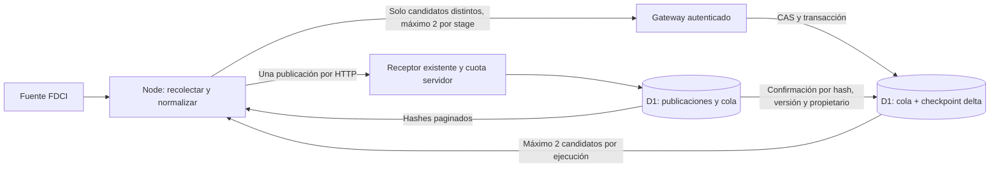

# FDCI: comparación incremental y cola durable — implementación local

Base `888afea`. 4/11/2026. No hubo importaciones, consultas autenticadas, escrituras
D1 remotas, cambios de credenciales, cron, push ni despliegues. Se preservaron los
archivos ajenos y el canary de observabilidad. Solo se consultó documentación pública
de cuotas, además de código y evidencias locales.

## Auditoría del recolector y alcance

El recolector existente obtiene `getCapaActivas`, `getRestoCapas` y un detalle
`getCupo` por curso activo. IDs y claves compuestas permiten identificar registros;
`prepareFdciImports` calcula en Node hashes de contenido, metadata, fechas y estado.
`sourceUpdatedAt` puede faltar y no constituye por sí solo prueba de ausencia de
cambios. `requestJson` no utiliza ETag/If-None-Match ni conserva validadores HTTP.
La evidencia local no demuestra soporte oficial de esos mecanismos ni un contrato
de paginación/completitud. No se inventó un endpoint delta ni se consultó la fuente.

**Límite real:** seis solicitudes, dos para listados y hasta cuatro detalles sin
fallos. Si hay más de cuatro cursos activos que requieren detalle, el recolector
no puede completar la comparación en esa corrida. Ahora falla cerrado sin afirmar
escaneo completo, sin vaciar la cola y sin eliminar históricos. Este bloqueo está
probado con cinco cursos. Completar la recolección con ese presupuesto requerirá
posteriormente snapshots/cursores de lectura de fuente; no se amplió el límite.

Los catálogos de 30/259/500/1.000 usados abajo son **comisiones sintéticas** de un
curso, no la cantidad actual real. El dato local histórico de 259 capacitaciones
generales no prueba 259 comisiones activas. `scope=active` no cubre automáticamente
cambios de comisiones que dejaron de aparecer en el listado activo.

## Arquitectura implementada, opt-in y deshabilitada



- Nueva migración **local** `0034_fdci_delta_queue.sql`: cola con ID único, secuencia
  FIFO, payload normalizado, hash y versión; checkpoint delta con revisión CAS,
  último ID staged y fecha del último escaneo completo según el contrato local.
  No modifica publicaciones, históricos, `sync_state`, ni el checkpoint 0032.
- `FDCI_DELTA_ENABLED=true` tendría que aprobarse/configurarse en Node y gateway.
  Ausente/false mantiene el flujo previo; ruta delta cerrada antes de D1. No se
  agregó el flag a configs ni workflows. No hay activación implícita.
- Se reutilizan identidad D1, secreto exclusivo, SHA, propietario, concesión <=600 s,
  slot de dos horas, suspensión persistente y cuota automática de **dos intentos**.
  Node delta también rechaza un límite superior a dos.
- Manifiestos `confirmed` y `queued` devuelven hasta 200 hashes por petición.
  La respuesta confirmada procede de publicaciones efectivamente persistidas;
  un hash en cola nunca se presenta como confirmación de publicación.
- Node compara ambos mapas, filtra protegidos y envía únicamente payloads nuevos
  o modificados. Un candidato ya pendiente idéntico no se vuelve a encolar.
- `stage` recibe hasta dos candidatos y conserva primero revisión/propietario en
  un token generado en servidor. Las inserciones dependen de ese token en el mismo
  `DB.batch` transaccional. Si CAS pierde, no se encola; un fallo SQL revierte el
  batch. La concesión se comprueba al admitir la transacción; sus operaciones
  dependientes no pueden intercalarse con otro propietario dentro del batch.
- Cambios posteriores de un mismo ID actualizan su versión, conservando su posición
  FIFO. Se mantiene el **último estado observado**, no un historial de cada versión
  transitoria del origen. Una novedad que nunca fue observada no puede garantizarse.
- Cola acotada a 1.000 IDs: al llenarse rechaza nuevos ingresos, sin descartarlos
  silenciosamente ni avanzar el checkpoint. Exige intervención; puede impedir
  continuar una corrida hasta recuperar capacidad bajo autorización. No es una
  cola infinita ni un mecanismo para eludir las cuotas D1.
- `ack` retira un candidato solamente si la publicación D1 tiene el mismo hash,
  fuente y estado no eliminado, y la fila en cola conserva ID/hash/versión esperados.
  La confirmación y retirada están cercadas por CAS y propietario.
- Publicar y confirmar cola son requests separados: no se promete una transacción
  distribuida. Si se pierde el ACK de publicación, la cola queda; al recuperar,
  Node comprueba D1 y confirma sin repetir esa publicación. Si se pierde el ACK de
  retirada, la siguiente lectura de cola/publicaciones establece el estado real.
  No se reintentan escrituras ambiguas dentro de la corrida.
- Las colecciones incompletas no actualizan `last_complete_scan_at`, ni drenan
  observaciones viejas. Una colección completa vacía no elimina pendientes. Los
  candidatos ausentes del catálogo actual se conservan para revalidación y no
  bloquean a otros candidatos presentes. No hay reconciliación de ausencias.

El checkpoint delta registra staging confirmado, no una afirmación de que ya se
publicó todo. El resultado separa examinados, encolados, publicados, confirmados
desde D1 y pendientes. Los errores conservan contadores conocidos y marcan
incertidumbre; no sustituyen una respuesta ambigua por un éxito o por cero cambios.

El runner CLI no tiene lector CPU remoto fiable: aun con datos correctos,
**mantiene HALTED por CPU_EVIDENCE_UNAVAILABLE**. Se probó el modo nuevo a través
de esa fachada sin simular una aprobación remota de CPU.

## Pruebas y benchmark

**43 comprobaciones distintas correctas:** trece nuevas delta; ocho del receptor;
trece de automatización; seis gateway/aislamiento; tres del canary de configuración.
Se cubren ACK de publicación, staging y retirada perdidos; recuperación sin reenvío
de publicaciones confirmadas; rollback, CAS concurrente, expiración, propietario,
secreto, flags, histórico UNKNOWN, saturación, coalescencia, límites, fuente incompleta
y suspensión por CPU ausente. TypeScript y lint focalizado correctos.

`check-fdci-hybrid-boundary.mjs` confirma que los módulos pesados siguen solo en
Node. Worker: validación acotada, autenticación y SQL fijo; bundle local 66.244 bytes.
No se atribuye una reducción de CPU al tamaño del bundle ni al tiempo local.

Benchmark real **local** de Miniflare/Workerd y D1 efímera, 20 escenarios con
aserciones y salida externa del Worker bloqueada. Normalización y comparación en
Node; snapshots de fuente sintéticos, sin API oficial ni pausas. Excluye arranque,
apertura/cierre y parte de la fachada automática. Instrumentación de `meta` suma SQL,
filas leídas y escritas físicamente; no son métricas de facturación remota.

Evidencia: `docs/evidence/2026-11-04-fdci-delta-local.json`, 4/11/2026 04:34:17 UTC.
Una muestra por escenario, no percentiles ni máximo de capacidad. El tiempo delta
incluye transporte loopback y D1; no es CPU Cloudflare. `process.cpuUsage` es CPU
del proceso Node con resolución gruesa en Windows; sus ceros no indican CPU cero.

| N | Eventos / IDs distintos | Node normalización ms | Delta transcurrido ms | Requests gateway | SQL | Filas leídas | Escritas físicas | Publicadas / pendientes |
|---:|---:|---:|---:|---:|---:|---:|---:|---:|
| 30 | 0 / 0 | 5,53 | 37,73 | 5 | 16 | 76 | 1 | 0 / 0 |
| 30 | 2 / 2 | 1,99 | 77,81 | 11 | 45 | 127 | 18 | 2 / 0 |
| 30 | 10 / 10 | 2,37 | 108,23 | 15 | 77 | 207 | 46 | 2 / 8 |
| 30 | 30 / 30 | 3,18 | 205,06 | 25 | 157 | 547 | 116 | 2 / 28 |
| 30 | 100 / 30 | 5,69 | 201,68 | 25 | 157 | 547 | 116 | 2 / 28 |
| 259 | 0 / 0 | 14,41 | 37,70 | 6 | 19 | 854 | 1 | 0 / 0 |
| 259 | 2 / 2 | 14,73 | 77,18 | 12 | 48 | 905 | 18 | 2 / 0 |
| 259 | 10 / 10 | 13,93 | 110,56 | 16 | 80 | 985 | 46 | 2 / 8 |
| 259 | 30 / 30 | 13,75 | 204,48 | 26 | 160 | 1.325 | 116 | 2 / 28 |
| 259 | 100 / 100 | 15,36 | 517,51 | 61 | 440 | 4.090 | 361 | 2 / 98 |
| 500 | 0 / 0 | 37,18 | 43,69 | 7 | 22 | 2.420 | 1 | 0 / 0 |
| 500 | 2 / 2 | 39,57 | 85,10 | 13 | 51 | 2.471 | 18 | 2 / 0 |
| 500 | 10 / 10 | 36,97 | 123,30 | 17 | 83 | 2.551 | 46 | 2 / 8 |
| 500 | 30 / 30 | 38,97 | 220,39 | 27 | 163 | 2.891 | 116 | 2 / 28 |
| 500 | 100 / 100 | 39,61 | 533,07 | 62 | 443 | 5.656 | 361 | 2 / 98 |
| 1.000 | 0 / 0 | 75,67 | 62,76 | 10 | 31 | 9.027 | 1 | 0 / 0 |
| 1.000 | 2 / 2 | 76,13 | 112,79 | 16 | 60 | 9.078 | 18 | 2 / 0 |
| 1.000 | 10 / 10 | 72,42 | 144,60 | 20 | 92 | 9.158 | 46 | 2 / 8 |
| 1.000 | 30 / 30 | 73,10 | 225,86 | 30 | 172 | 9.498 | 116 | 2 / 28 |
| 1.000 | 100 / 100 | 75,50 | 571,80 | 65 | 452 | 12.263 | 361 | 2 / 98 |

Todas las publicaciones del benchmark ya existían: son actualizaciones, no altas.
100 eventos sobre 30 IDs producen como máximo 30 estados finales distintos; no se
inventaron 100 publicaciones diferentes. La única escritura del escenario sin
cambios es el checkpoint de escaneo; cero escrituras de publicaciones y cero cola.
Índices y checkpoints explican escrituras físicas superiores a publicaciones.

**Ahorro demostrado:** ya no se hace un request de publicación/checkpoint por
registro inalterado. Para recorrer 1.000 sin cambios, el algoritmo previo con lote
dos requeriría 500 corridas y 2.502 requests internos del escáner (lectura de cursor
por corrida, start/finish y publicación/avance por registro), sin controles externos.
El núcleo delta examina ese snapshot en una corrida con diez requests. Es una
comparación de estructura y alcance completo, no un benchmark remoto de costos.
No comparar diez contra los siete requests de un lote antiguo de solo dos registros.

**Lecturas aún presentes:** manifiestos hacen SELECT paginados de hashes. En el
fixture de 1.000 se leen 9.027 filas por escaneo sin cambios, no 1.000 ni cero.
La selección/ordenación con índices actuales y los checks de cada request contribuyen.
No se añadió un índice a publicaciones ni se promete eliminar toda lectura por ID.
El conteo de capacidad de cola también lee filas de cola; ráfagas grandes elevan SQL.

## Capacidad y atraso acumulado

Se conservan dos intentos cada dos horas: 24 cambios/día nominales, aproximadamente
15/día con la reserva previa (25 % de turnos no productivos y 20 % de trabajo extra).
Ahora esa capacidad se usa para **IDs modificados**, no para todo N. La reserva no
autoriza reintentos ambiguos ni reanuda HALTED automáticamente.

| Ráfaga de IDs distintos | Publicados primera corrida | Cola restante | Vaciado nominal desde espera completa | Con reserva | Backlog tras 24 h nominal / reservado |
|---:|---:|---:|---:|---:|---:|
| 0 | 0 | 0 | No hay despacho | No hay despacho | 0 / 0 |
| 2 | 2 | 0 | 2 h | 6 h | 0 / 0 |
| 10 | 2 | 8 | 10 h | 16 h | 0 / 0 |
| 30 | 2 | 28 | 30 h | 48 h | 6 / 15 |
| 100 | 2 | 98 | 100 h | 160 h | 76 / 85 |

Para N=1.000 con dos o diez cambios observados por día, la cola puede encajar en
24 h bajo esos supuestos sin revalidar/publicar los 1.000 uno por uno. Para treinta
o cien IDs nuevos/modificados diarios, el backlog crece. Para estabilidad, la tasa
de llegada única debe ser menor al servicio, no igual al máximo sin margen.
Se conservan las últimas versiones de IDs ya pendientes, no todas las versiones
intermedias. Bootstrap sin hashes confirmados en D1 podría encolar todo N: no se
presenta como un caso de cero cambios ni cumple mágicamente el objetivo.

Estas conclusiones requieren colección completa, observaciones recientes y
confirmaciones disponibles. Con más de cuatro cursos que requieren detalle no se
ha demostrado esa condición. Las pausas, recuperación humana tras HALTED y los
retrasos del programador pueden incumplir 24 h aunque el promedio de cambios sea bajo.

## Costos y convivencia: estimaciones, no uso real de cuenta

- 12 corridas/día → 360/mes. Jobs Linux estándar de 1–3 minutos: 360–1.080 minutos,
  equivalentes a USD 2,16–6,48 del cómputo incluido en repositorios privados.
- GitHub Free privado: USD 12/mes de cómputo incluido, artefactos 500 MB; runners
  estándar públicos gratuitos. Otros workflows comparten presupuesto. Ejemplo
  hipotético: dos fuentes a 12 corridas diarias y cuatro a una diaria, dos minutos
  por job → 1.680 minutos/USD 10,08 mensuales. Si seis fuentes corrieran cada dos
  horas, dos minutos/job → 4.320 minutos/USD 25,92, fuera del cupo privado. No son
  frecuencias autorizadas ni una evaluación de los SLA de otros módulos.
  [Facturación GitHub](https://docs.github.com/en/billing/concepts/product-billing/github-actions).
- Replicar el patrón medido N=1.000 sin cambios 360 veces: 3.600 requests internos,
  11.160 SQL, 3.249.720 lecturas y 360 escrituras/mes; 108.324 lecturas/día. Faltan
  controles de concesión, fachada y cierre. No es el costo total de producción.
- Replicar el patrón inicial de cien cambios: 780 requests internos, 147.156
  lecturas y 4.332 escrituras/día. No es una cota del estado sostenido: una cola
  previamente grande y otras publicaciones de la base pueden elevar las lecturas.
  La capacidad de despacho seguiría siendo 24/día y el atraso no sería sostenible.
- Workers Free comparte 100.000 requests/día por cuenta y mantiene CPU HTTP 10 ms;
  D1 Free: cinco millones de lecturas/día, 100.000 escrituras/día, 5 GB totales.
  La web, Noticias, SIME, demás importadores y recordatorios también consumen.
  No se consultó el uso restante ni se garantizó capacidad gratuita. No se creó
  ningún nuevo servicio, dependencia o credencial administrativa.
  [Workers](https://developers.cloudflare.com/workers/platform/limits/),
  [D1](https://developers.cloudflare.com/d1/platform/pricing/).

## Reproducción y dictamen

```powershell
node --test scripts/fdci-delta.test.mjs
node scripts/bench-fdci-delta-local.mjs
node scripts/check-fdci-hybrid-boundary.mjs
```

El benchmark usa loopback/Workerd, no un canary remoto. 0034 se aplicó únicamente
en bases efímeras locales. No se modificaron las configuraciones productivas,
workflows ni el fichero canary de observabilidad. No se activó el flag delta.

**APTO CON CONDICIONES como prototipo local; NO APTO para activar automatización
productiva todavía.** Hay ahorro real de requests de publicación cuando no cambia
el contenido y conservación durable de cambios aceptados. No hay demostración
general de 24 h: faltan completar lecturas multi-curso bajo el presupuesto de seis,
conocer la tasa real de cambios y medir CPU individual completa en Cloudflare.
El umbral sigue en **7 ms**; 1102, D1/propietario/ACK ambiguo o CPU ausente mantienen
la suspensión. No se sustituyó ese requisito con tiempos locales o percentiles.
Antes de un ensayo remoto deben autorizarse por separado migración y despliegue
canary cerrado, sin tocar el ensayo independiente de observabilidad existente.
