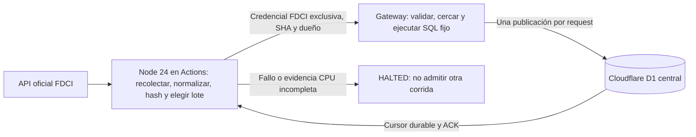

# FDCI: arquitectura híbrida Node / GitHub Actions + Cloudflare Free

Base `3509b9b`, 4/11/2026 (Argentina). Inspección y pruebas exclusivamente locales.
No se consultaron cuentas, cuotas consumidas, D1 remota ni fuentes educativas reales.
Se verificaron cuotas publicadas en documentación oficial. Se preserva el canary
de observabilidad como prueba independiente, sin cambios ni despliegue.

## Hallazgo y decisión mínima

**El traslado del trabajo pesado ya existe en el código.** No corresponde crear
otro importador ni retirar validación del servidor para aparentar una migración.
La CPU remota observada anteriormente no demuestra que el Worker recolecte o
normalice el catálogo. Sigue siendo necesario medir el costo de su camino residual.

| Trabajo FDCI | Implementación actual / lugar |
|---|---|
| Leer API oficial, presupuestar solicitudes y pausas | `scripts/import-via-gateway.mjs`, `import-fdci.mjs`: Node |
| Orden estable, corte por lote, selección de pendientes y decisión de cursor | `scripts/fdci-incremental.mjs`: Node |
| Unir curso/comisión, interpretar contenido y fechas, inferir circuito, hashes | `lib/fdci-import.ts`, `training.ts`, `circuits.ts`, `sync-diff.ts`, `publication-lifecycle.ts`, ejecutados por Node |
| SHA, ejecución única, resultado, cancelación y solicitud de suspensión | `scripts/fdci-automation.mjs`, `fdci-automation-history.mjs`: Node |
| Autenticación, identidad D1, propietario, TTL, cuota y latch persistente | `workers/source-import-gateway.mjs`, `fdci-automation.mjs`: Worker |
| Validar payload acotado, comparar hashes ya calculados y guardar | `workers/fdci-receiver.mjs`: Worker + SQL fijo |
| Persistir cursor con revisión y propietario | `workers/fdci-checkpoint.mjs`: Worker + SQL fijo |

El receptor no recalcula hashes ni procesa el catálogo. Sí valida textos, URLs,
fechas, JSON y formato del hash recibido: es control de una frontera de confianza,
no debe eliminarse. El hash del runner no constituye firma de veracidad del origen.
El gateway compartido también incluye receptores SIME/Juntas y la lista estática
de fuentes de Juntas; no se cambiaron esos componentes.



No se entrega a Actions un token Cloudflare ni D1 Edit. El `GITHUB_TOKEN` se limita
a `contents:read` y `actions:read`; secreto FDCI exclusivo en entorno protegido.
El piloto humano conserva su entorno; la automatización propuesta utiliza otro.
Acciones y revisión ejecutable deben fijarse a SHAs completos aprobados.

## Gateway liviano y transacciones: contrato reutilizado

- Operaciones explícitas: identidad, start, import, checkpoint, close, finish.
  Nunca SQL, nombres de tablas ni fuentes arbitrarios recibidos del cliente.
- Fachada automática: dos intentos de publicación por concesión, un registro por
  petición; cuerpo máximo 150.000 bytes, TTL servidor <=600 s, un propietario,
  franja de ejecución y SHA aprobados. `scope=active`, seis solicitudes oficiales
  y pausas >=400 ms se controlan en el runner. El servidor no puede demostrar qué
  solicitudes hizo un runner comprometido a la API oficial.
- SQL de publicación condicionado a concesión no vencida y propietario. Fuente
  fija, protección `6375` / `UNKNOWN`, sin borrados ni reconciliación `sync_state`.
  Hash idéntico no produce UPDATE de publicación.
- `DB.batch` proporciona transacción para las escrituras de cada lote; una
  publicación es una unidad SQL. Apertura/control usan el batch existente.
  [Garantía oficial de batch](https://developers.cloudflare.com/d1/worker-api/d1-database/#batch).
- **Publicación y avance del cursor son requests separados**, no una transacción
  distribuida. El runner avanza solo después de ACK válido. Si se pierde el ACK,
  no reintenta automáticamente; bajo recuperación autorizada, el mismo registro
  puede revisarse otra vez y la deduplicación por ID/hash evita duplicación.
  El checkpoint usa revisión esperada y cerco SQL de propietario/expiración.
- El lote no es una transacción de todo el catálogo. Los progresos confirmados
  sobreviven a fallos posteriores. No prometer atomicidad de toda la corrida.
- TTL cierra acceso, pero no prueba éxito. RUNNING vencido se convierte en HALTED;
  la recuperación no es automática. El control limita actualmente la autorización
  a una ventana de hasta 24 h: no sirve como autorización indefinida de un cron.

No se añadieron rutas, cambios de autenticación ni migraciones. La propuesta
reutiliza 0031/0032 y el control local 0033; su preparación/remoto requieren
autorización y verificación independientes. No se aplicó ninguna migración.

## Código local nuevo y evidencia

`scripts/check-fdci-hybrid-boundary.mjs` construye los dos grafos con el esbuild ya
instalado. Exige que los siete módulos de recolección/transformación estén en Node
y fuera del Worker, y que el bundle del Worker no contenga el origen oficial FDCI.
Falla ante nuevas dependencias de aplicación en el gateway, salvo la lista
estática de Juntas ya existente. No instala dependencias ni conecta a Cloudflare.
El bundle inspeccionado mide **59.858 bytes**, sin minificar; no equivale a CPU.

`scripts/fdci-hybrid-local.test.mjs` ejecuta el runner real en Node frente al
gateway real empaquetado en Miniflare/Workerd, D1 efímera y fuentes sintéticas:

- Dos comisiones se convierten en Node a payloads de una publicación, con metadata
  y hash preparados antes de entrar al Worker.
- Dos altas; segundo ciclo: cero altas, cero actualizaciones, dos sin cambios,
  cero escrituras de publicaciones según ACK; dos publicaciones al terminar.
- Cursor durable: ciclo pasa de 1 a 3 después de los dos recorridos completos.
- Seis solicitudes de fuente en Node en total (tres por ciclo); **cero solicitudes
  externas del Worker**, con salida de red del Worker interceptada y prohibida.
- Solicitud de importación sin autenticación: 401.

Resultado: **2/2 pruebas nuevas correctas**, lint focalizado correcto. La primera
ejecución en sandbox no pudo usar loopback (`EACCES`); se repitió permitiendo solo
la ejecución local del test. No fue un fallo de Cloudflare. No se repitieron las
39 pruebas anteriores ni campañas de rendimiento.

Comprobaciones reproducibles, desde la raíz del repositorio:

```powershell
node scripts/check-fdci-hybrid-boundary.mjs
node --test scripts/fdci-hybrid-local.test.mjs
node node_modules/eslint/bin/eslint.js scripts/check-fdci-hybrid-boundary.mjs scripts/fdci-hybrid-local.test.mjs
```

Esto demuestra la separación actual, **no una reducción nueva de CPU**. No se
modificaron el runner funcional ni el Worker porque ya cumplen esa distribución.
No hay métricas remotas nuevas ni CPU facturable medida en este trabajo.

## Objetivo de actualización <=24 h

Con dos publicaciones por corrida cada dos horas hay **12 corridas / 24 revisiones
por día**, solo con ejecuciones exitosas y sin retrasos. Un catálogo estable de N
comisiones necesita aproximadamente `2 × ceil(N/2)` horas por ciclo, contando la
espera hasta el siguiente turno: 10 →10 h, 24 →24 h, 30 →30 h. Fallos, registros
protegidos y cuotas consumen capacidad o retrasan el ciclo.

Una publicación nueva con clave anterior al cursor puede esperar al siguiente
ciclo; de forma conservadora presupuestar hasta dos ciclos para incorporaciones
durante el recorrido. Aun N=24 no demuestra <=24 h para ese caso. No se garantiza
un SLA de 24 h con estos límites ni con GitHub schedule gratuito.

Mantener lote dos en el piloto. Antes de activar: conocer el tamaño elegible y
la antigüedad del último ciclo completo; alertar al superar 24 h sin afirmar que
la fuente está actualizada. Si la proyección excede 24 h, pedir autorización para
ajustar frecuencia o número de peticiones pequeñas por corrida, respetando cuotas
y métricas CPU; no aumentar el payload del Worker ni saltarse pendientes. Con
fallos de seguridad/recursos, prevalece la suspensión aunque se incumpla frescura.
Este informe no modifica frecuencia, slot servidor ni presupuesto alguno.

## Cuotas gratuitas verificadas y estimaciones

| Recurso | Cuota pública / riesgo |
|---|---|
| Workers Free | 100.000 requests/día por cuenta; CPU HTTP 10 ms. El gateway conserva ese límite aunque Node haga el resto. Web y demás Workers comparten presupuesto. [Límites](https://developers.cloudflare.com/workers/platform/limits/) |
| D1 Free | 5 millones filas leídas/día, 100.000 escritas/día, 5 GB totales y 10 bases. Índices también pueden aumentar escrituras físicas. [Precios](https://developers.cloudflare.com/d1/platform/pricing/) |
| Actions público | Runners estándar gratuitos; no inferir gratuidad de runners grandes ni recursos de terceros. [Facturación](https://docs.github.com/en/billing/concepts/product-billing/github-actions) |
| Actions privado, GitHub Free | La documentación actual expresa $12/mes de cómputo incluido y 500 MB de artefactos; Linux estándar $0,006/min, equivalente orientativo a 2.000 min si no se comparte con otros consumos. Caché 10 GB/repositorio; no confundir con artefactos. Mismo enlace oficial. |
| Programador Actions | Puede retrasar o descartar jobs; solo rama predeterminada; en repositorios públicos puede desactivarse tras 60 días sin actividad. [Schedule](https://docs.github.com/en/actions/reference/workflows-and-actions/events-that-trigger-workflows#schedule) |

Estimaciones, no mediciones: 12 corridas/día son 360/mes de 30 días. Jobs de
1/3/5 minutos consumen 360/1.080/1.800 minutos; en Linux estándar privado equivalen
a $2,16/$6,48/$10,80 del cupo, antes de otros usos. Evitar reinstalar toda la web
por corrida: el importador Node usa módulos locales y primitivas Node, no el build
web. No cambiar el workflow ni publicar nada en esta etapa.

Máximo 72 solicitudes oficiales/día; con un supuesto de 12–20 requests al gateway
por corrida serían 144–240 requests/día. Debe medirse el total real incluyendo
identidad, control, checkpoint, reporte y cierre, no solo los ACK de publicaciones.
Si cada corrida leyera R filas y escribiera W físicamente: `12R` y `12W` diarios.
Ejemplo de presupuesto reservado, **no consumo medido**: R<=1.000 y W<=100 darían
<=12.000 leídas y <=1.200 escritas/día. No repetir escaneos globales de integridad
por corrida: los 14.212 leídos en un ensayo anterior incluían controles ajenos al
ACK. La capacidad gratuita restante de esta cuenta no se consultó ni se garantiza.

## Matriz para las siguientes fuentes (diseño, sin modificarlas)

| Módulo | Ya reutilizable en Node | Mantener en Cloudflare | Adaptación / riesgo pendiente |
|---|---|---|---|
| Noticias | `scripts/discover-news.mjs`, `lib/news-discovery.ts`: feeds y candidatos editoriales | D1, publicación editorial autenticada, lectura pública | El CLI REST actual requiere revisar alcance del token; proponer gateway de candidatos con operaciones fijas antes de automatizar. Nunca auto-publicar ni llevar permisos administrativos al runner. |
| SIME | `scripts/import-sime.mjs`, `sime-collector.ts`, `sime-import.ts`: descarga y normalización | Receptor con fuente fija, identidad, cercos y upsert | Su validación previa no autoriza activar. Preservar límites/Junta/cursor; medir su propio presupuesto y bloquear escritores paralelos. |
| Designaciones | Hechos públicos provenientes de SIME; `lib/designations.ts` | Perfil, matching privado y seguimiento autenticado (`personalized-catalog.ts`) | No es otro recolector. No enviar perfiles a Actions ni materializar matching masivo como parte de importar SIME. Evaluar por separado solo derivaciones públicas costosas. |
| Padrones / Juntas | `scripts/import-juntas-checkpoint.mjs`, `juntas-gateway-db.mjs`: recorrido incremental y preparación | Checkpoint cercado, identidad, fuente y persistencia | Mantener validación CPU remota pendiente; no importar históricos masivamente ni adoptar privilegios REST globales. |

Las sesiones, perfiles, Agenda y avisos privados siguen en el backend autenticado.
No se distribuyen en artefactos públicos, caché CDN ni logs del runner.

## Secuencia mínima y dictamen

1. Conservar cierre, suspensión y cron deshabilitado. Revisar el SHA del paquete
   y los cambios exclusivamente locales antes de publicar en otra etapa.
2. Bajo autorización separada, usar el canary de observabilidad de `3509b9b` para
   demostrar lectura de CPU individual; no modificarlo como parte de esta tarea.
3. Solo después autorizar un ensayo híbrido finito con D1 sintética exclusiva y
   controles necesarios, sin permisos de cuenta para el runner. Validar **todas**
   las invocaciones, incluido reporte/cierre. No ampliar permisos ante el 403.
4. Suspender ante CPU individual >7 ms, 1102/exceededCpu, D1, autenticación,
   propietario o ACK ambiguo. Sin CPU completa no permitir otra corrida. La
   implementación actual ya falla cerrado; no se eliminó ese bloqueo.
5. Autorizar posterior piloto manual productivo solo con margen y cierre probados.
   Cualquier schedule requiere autorización adicional, capacidad <=24 h evaluada
   y procedimiento de recuperación de HALTED. No habilitar indefinidamente la
   ventana de 24 h ni silenciar el lector CPU ausente para hacer funcionar cron.

Rollback: no cambiar el Worker web; cerrar únicamente la automatización/gateway
bajo autorización, conservar D1/cursor y detener futuras corridas. Revertir código
no revierte D1. Sin borrados/restauraciones automáticas.

**APTO CON CONDICIONES para un futuro piloto híbrido aislado; NO APTO para activar
automatización desatendida hoy.** Riesgos bloqueantes: evidencia CPU individual
incompleta y ausencia de lector remoto fiable; ventana deliberadamente finita.
Riesgo de capacidad: dos registros cada dos horas no demuestran 24 h de frescura
para todos los catálogos. Trasladar lo ya ejecutado en Node no resuelve esos límites.
